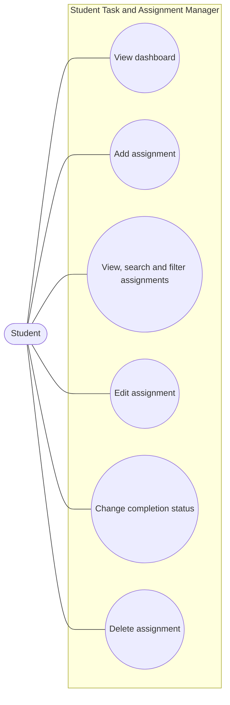
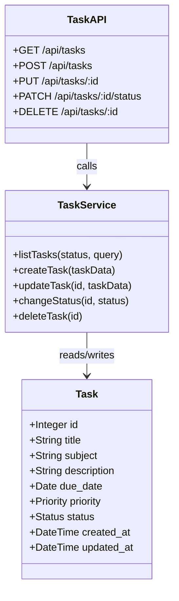
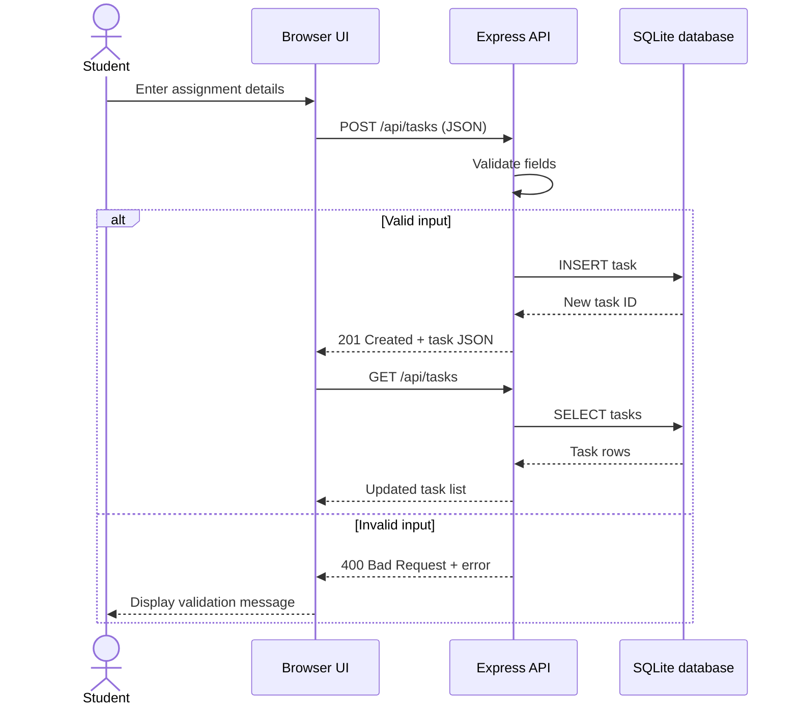
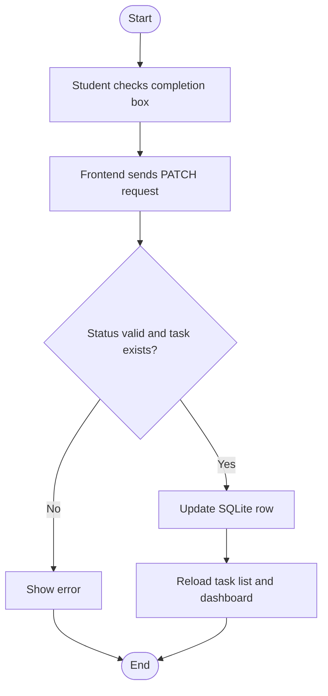
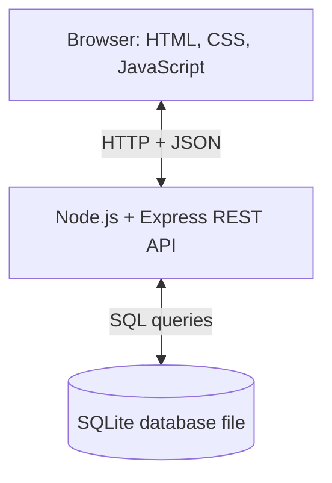

# UML and Design Diagrams

These diagrams can be pasted into a Mermaid-compatible Markdown viewer or recreated in draw.io/StarUML for the report.

## 1. Use-case diagram (text representation)

## 2. Class/data model

## 3. Sequence diagram: create assignment

## 4. Activity diagram: task completion

## 5. Architecture diagram

